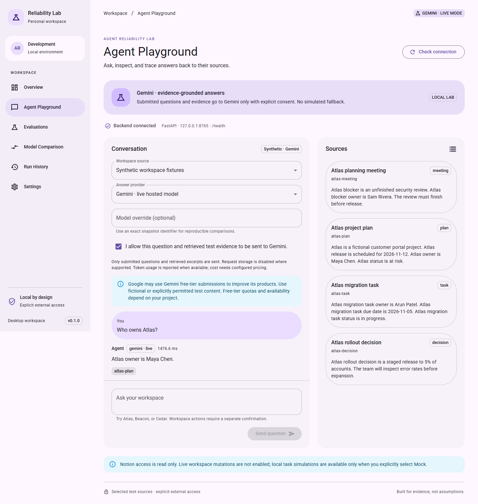
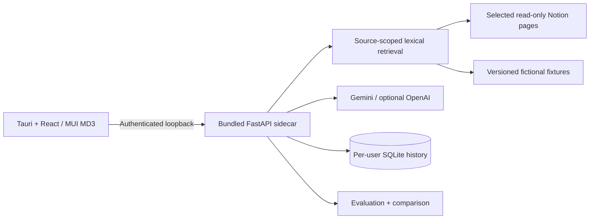

# Agent Reliability Lab

**Evidence-grounded answers from selected Notion pages, with an evaluation lab to measure where an agent succeeds and fails.**

The desktop app uses **live Gemini by default**. It retrieves authorized Notion content, asks Gemini to select supporting excerpts, validates every source identifier and quote, and displays the evidence beside the answer. Missing credentials, quota failures, and invalid output produce errors; they never trigger a simulated fallback.



[Download desktop releases](https://github.com/codejoetheduke/agent-reliability-lab/releases) · [Build status](https://github.com/codejoetheduke/agent-reliability-lab/actions/workflows/ci.yml) · [Getting started](docs/getting-started.md) · [Development](docs/development.md)

This repository and its releases are private. Access requires repository permission. The first release is an unsigned private preview, not a public Notion integration or an officially endorsed Notion product.

## What it does

- **Ask and inspect:** query selected Notion pages or fictional project fixtures; follow validated excerpts back to their sources.
- **Measure behavior:** run a versioned 29-case dataset covering retrieval, answers, uncertainty, injected failures, and isolated action controls.
- **Inspect failures:** review expected criteria, raw outcomes, citations, timing, and metric numerators/denominators.
- **Compare compatible runs:** compare models with matching datasets and evaluation conditions, including latency distributions, reported usage, and descriptive intervals.
- **Keep control:** Notion access is read only. Hosted submissions require explicit consent. Experiment history stays local and has deletion controls.

Gemini is the default provider; OpenAI is also supported. An explicit **Mock** option remains for offline tests and clearly labeled simulations. It is not the deployed default. Task creation/update currently exists only in that local simulation mode; live Notion mutations are unavailable.

## Install and connect

| Computer                             | Release asset         | Scope                                                  |
| ------------------------------------ | --------------------- | ------------------------------------------------------ |
| Windows 10/11 x64                    | NSIS setup `.exe`     | WebView2 required; installer can provision its runtime |
| macOS 13+ Apple Silicon              | `aarch64.dmg`         | Separate native ARM build                              |
| macOS 13+ Intel                      | `x64.dmg`             | Separate native Intel build                            |
| Ubuntu 22.04+ / compatible Linux x64 | `.deb` or `.AppImage` | WebKitGTK 4.1 and compatible system libraries          |

Installed releases bundle Python and the frontend. **Node, Python, Rust, and terminal startup commands are not required to run them.** Builds are native to each target; this is not a promise of compatibility with every Linux distribution, older OS, or unsupported architecture.

Each user supplies their own credentials in `~/.agent-reliability-lab/credentials.json`:

```json
{
  "GEMINI_API_KEY": "your-private-google-ai-studio-key",
  "GEMINI_MODEL": "gemini-3.5-flash-lite",
  "LAB_DEFAULT_PROVIDER": "gemini",
  "NOTION_API_KEY": "your-private-read-content-connection-token",
  "NOTION_ROOT_PAGE_IDS": "your-selected-test-page-uuid"
}
```

Keep this file outside the checkout, restrict its OS permissions, and never commit it. No developer key, private page ID, workspace content, or account quota is bundled in an installer.

Share the selected test page with its Notion connection. Open **Settings → Check Notion connection**, then **Agent Playground**. Select Notion, inspect its records, grant consent for the submitted evidence, and ask a question. See [the complete setup and first-run walkthrough](docs/getting-started.md).

**Gemini free tier is project-dependent, quota-limited, and may use submissions to improve Google's products.** Use fictional or explicitly permitted test content. The app does not enable billing or promise zero cost; monetary estimates remain unavailable unless matching rates are configured. [Google's current policy/pricing table](https://ai.google.dev/gemini-api/docs/pricing)

## A real demonstration, including a failure

Gemini successfully answered a fictional Atlas ownership question with a valid citation, and answered the stated purpose of the authorized Notion test page with a valid source excerpt. The private Notion content and identifiers are excluded from this repository.

The initial full live benchmark passed **28/29** cases. Its failure was useful: Gemini chose Atlas's release date for an ambiguous question that could also refer to Beacon. Citation validity alone did not establish that the answer was appropriate. The original report is preserved; the subsequent prompt explicitly requires clarification when several subjects could answer an unspecified question.

With prompt v2, Gemini 3.5 Flash-Lite passed **29/29**, while Gemini 3.1 Flash-Lite passed **25/29** under matching conditions. The latter run recorded two timeouts, one invalid output, and one ambiguity failure. The compatible comparison shows four improved case outcomes for 3.5 on this small suite; it does not establish statistical significance or population accuracy.

[Initial real Gemini report](docs/gemini-initial-evaluation-report.json) · [Current real Gemini report](docs/gemini-evaluation-report.json) · [Metric definitions and limitations](docs/metrics.md)

[Second real model run](docs/gemini-comparison-evaluation-report.json) · [Compatible real-model comparison](docs/gemini-model-comparison-report.json)

These small, curated checks are not population accuracy. Four deliberate provider faults and five local action scenarios are control cases, not successful Gemini requests. Original mock sample reports remain labeled as simulations.

## Develop from source

Prerequisites: Node 24, Python 3.12, Rust 1.89+; Windows Visual Studio C++ tools/WebView2, macOS Xcode command-line tools, or the [Tauri Linux packages](https://v2.tauri.app/start/prerequisites/).

```sh
python -m venv .venv
node scripts/python.mjs -m pip install -r apps/backend/requirements-dev.lock -r apps/backend/requirements-build.lock
node scripts/python.mjs -m pip install --no-deps -e apps/backend
npm ci
npm run dev:web
```

On Linux/macOS use `python3` for the first command if `python` is unavailable. The Node helper selects the correct virtual-environment path on all three systems.

```sh
npm run test:backend
npm run typecheck
npm run lint
npm test
npm run test:e2e
npm run package:backend
npm run test:sidecar
npm run package:desktop
```

`npm run dev:web` supervises the source backend and browser frontend. `npm run dev` opens Tauri after the sidecar has been built once. `npm run package:desktop` freezes Python and creates native bundles. See [development commands, architecture, and module ownership](docs/development.md).

## CI/CD and release guarantees

Pull requests and main-branch changes run backend/frontend checks on Windows, macOS, and Linux, plus real-service Chromium workflows on Linux. Four native jobs then freeze Python, exercise its authenticated APIs and parent shutdown, lint Rust, and build installers for Windows x64, Linux x64, macOS ARM64, and macOS x64.

Version tags run the same checks. **Publication occurs only if every target succeeds.** The release job uploads installers and SHA-256 checksums, then publishes the private preview. Actions are pinned to immutable commits, build dependencies are locked, permissions are minimal, and CI requires no model or Notion credentials.

[Release process and signing limits](docs/releasing.md) · [Verification record](docs/verification.md) · [Contributing](CONTRIBUTING.md)

## Architecture and boundaries



The native host starts its own backend on an ephemeral loopback port, generates a per-launch nonce, verifies authenticated readiness, and stops the child on exit. Installed history uses the OS application-data directory; development history uses ignored `.local/`.

[Architecture](docs/architecture.md) · [Security/privacy](docs/security.md) · [Gemini adapter](docs/gemini.md) · [Notion scope and limits](docs/notion.md) · [Material Design 3](docs/design-system.md)

Current limits: extractive evidence selection rather than free-form synthesis; lexical rather than embedding retrieval; synthetic-only general benchmarks; no public Notion OAuth, live mutations, updater, code-signing credentials, or notarization. Workspace data is not used by this project to train models. Review the selected provider's own data-use terms separately.
