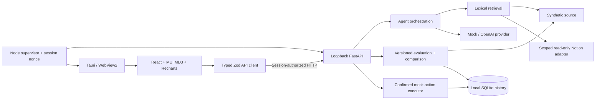

# Architecture

React owns presentation, provider/source choices, explicit consent, and confirmation dialogs. Retrieval, validation, scoring, comparison, persistence, and action authorization live in Python. Client schemas validate runtime data in addition to strict TypeScript. Feature pages and charts load on demand.

Source and provider protocols are separate: Notion can supply records without invoking a model. Synthetic retrieval is deterministic lexical matching with explicit project scoping; embeddings are deferred. The mock provider extracts labeled facts. Hosted output uses strict JSON and exact excerpts; citations must resolve to retrieved records and verbatim body text. Workspace instructions cannot grant action authority.

Runs save dataset/fixture snapshots, hashes, metric/prompt versions, retrieval k, provider/model, pricing assumptions, and execution settings. Sequential background tasks persist each case. Fault injections and isolated action stores are explicit. Restart marks unfinished runs interrupted; there is no distributed queue or automatic resubmission. Comparisons reject missing/incompatible conditions and show measured rates, denominators, shared latency bins, and descriptive intervals.

SQLite connections close explicitly, use WAL, and store JSON run payloads plus transactional task/proposal tables. History deletion rejects active runs. Task execution uses immutable proposals, confirmation, idempotency checks, and optimistic resource versions. The executor is local-only with no Notion write adapter.

Notion follows configured roots and validated contained descendants, handles current data sources and pagination, uses bounded retries, and rejects excessive snapshots. Actual page content stays in process memory and transient UI state, excluded from benchmark history/reports/fixtures. Hosted submission is an explicit user operation. See `notion.md`.

The supervisor binds the API to loopback and gives each launch a random nonce. Native React retrieves it through a narrow Tauri command; browser development HTML receives it through the supervised Vite plugin. Public health validates a service fingerprint; protected requests require the nonce. The launcher rejects occupied ports and cleans up owned children. CORS, Host validation, and CSP add browser boundaries; they do not defend against a compromised user account.

The Windows release embeds frontend assets and uses a separately installed Python environment. Backend packaging, installers, signing, updates, OS credential storage, and public Notion OAuth remain distribution work. macOS/Linux execution and native development HMR remain unverified. Portable structure is not proof of cross-platform compatibility.
