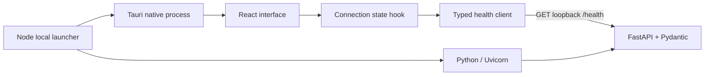

# Milestone 1 architecture

The official Tauri scaffold provides the native shell. React owns presentation and navigation only. The API client validates the runtime response as well as the TypeScript contract; an unrelated service on the same port cannot produce a false connected state. The hook aborts stale requests on navigation teardown/retry and polls every 15 seconds. Requests time out after four seconds.

FastAPI exposes a literal, versioned health schema. It reads no environment secrets and performs no external requests. CORS permits only known development and Tauri origins. The process binds to loopback and validates Host headers. Unexpected errors log only a fixed JSON event and return safe generic messages.

The launcher uses explicit process argument arrays, waits for backend readiness, rejects occupied ports, and owns child-process cleanup. Development uses Tauri's supported `beforeDevCommand` to start Vite. Production preview uses embedded frontend assets and a separately installed Python environment. This avoids prematurely building a Python packaging or sidecar distribution system. A release needs a packaged backend and stronger process/authentication guarantees first.

No database, provider adapter, retrieval pipeline, evaluation engine, chart library, or real connector is included in this milestone. Adding those now would exceed its scope. The run count is zero, and unmeasured statistics are dashes. No synthetic benchmark values are supplied.

The interface uses Material UI 9 with an explicit Material Design 3 theme, locally bundled fonts, shared presentation components, and adaptive drawer/rail/mobile navigation. See `design-system.md` for roles and design decisions. The native launcher locates Visual Studio with `vswhere`, initializes its developer environment, and forwards only native toolchain variables without printing them.

Windows browser workflows and the native production build/launch are verified. Embedded assets, fonts, and the permitted health request work under the production CSP in WebView2. Adversarial CSP testing, native development HMR, and macOS/Linux execution remain unverified. See `milestone-1.md` for the actual verification record.
